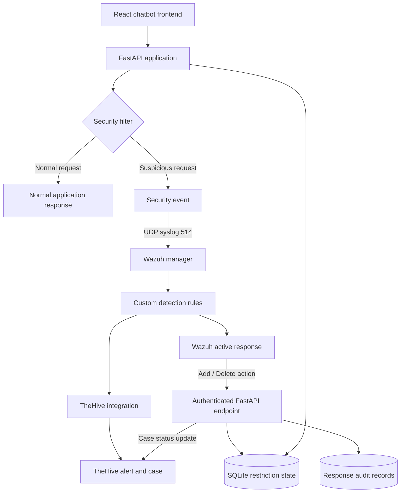

# Wazuh AI SOC: Security Monitoring and Automated Incident Response

A defensive cybersecurity implementation integrating a deliberately vulnerable AI chatbot, Wazuh SIEM, TheHive case management, and a custom response workflow.

This project explores how application-level security events can flow through detection, incident management, session containment, recovery, and audit logging.

**Status:** Working prototype. Core detection, alert-to-case integration, persistent session restriction, and manual recovery workflows have been tested. Full end-to-end validation of the Wazuh-triggered deletion and recovery path remains in progress.

## Objectives

- Forward structured security events from an application to Wazuh.
- Detect selected suspicious AI-abuse patterns using rule-based security checks and custom Wazuh rules.
- Create and link TheHive alerts and incident cases.
- Apply session restrictions through an authenticated FastAPI endpoint.
- Persist restriction state independently of Wazuh's runtime state.
- Support authorized restriction removal and linked case updates.
- Maintain audit records for response actions.

## Architecture

The diagram represents the intended workflow. Individual components and selected response paths have been tested; the complete Wazuh-triggered recovery lifecycle still requires end-to-end verification.

## Technology stack

- **Backend:** Python, FastAPI
- **Frontend:** React
- **SIEM:** Wazuh
- **Incident management:** TheHive
- **Storage:** SQLite
- **Infrastructure:** Docker Compose, Linux
- **Integration:** REST APIs, UDP syslog, Wazuh custom integrations and active-response scripts

## Detection rules

The project uses application-level rule-based checks to identify selected suspicious prompt patterns. Wazuh processes the resulting events through custom rules.

| Rule ID | Purpose | Level |
|---|---|---:|
| `100900` | Prompt-injection pattern | 10 |
| `100901` | Sensitive-information extraction pattern | 10 |
| `100902` | Safety-bypass pattern | 10 |
| `100903` | Active-response audit event | 3 |
| `100904` | Prompt-injection event reported by the application | 12 |

These rules are specific to this and are not intended to provide comprehensive attack detection. The detector is rule-based rather than a trained machine-learning model. Further testing is needed to measure false positives, false negatives, and resistance to obfuscated or multi-turn attacks.

## Incident management workflow

The custom TheHive integration processes Wazuh alerts and supports alert deduplication, case creation, and session-to-case linkage.

The application stores the relationship between a flagged session and its associated TheHive case. This allows the response workflow to reference the relevant incident during recovery.

The case-update integration uses an authenticated API request to transition the linked case to `Indeterminate`. The exact meaning of that status should be interpreted according to the configured TheHive version and workflow.

## Session restriction and recovery

The application exposes an authenticated FastAPI endpoint for adding and removing restrictions.

### Restriction

1. A suspicious interaction triggers the application's security filter.
2. The application emits a security event.
3. Wazuh evaluates the event against its configured rules.
4. A matching rule can trigger the configured active-response script.
5. The script sends an authenticated request to the application.
6. The application records the restriction in SQLite and records the response action.

### Persistence

The restriction is stored in SQLite rather than only in application memory.

During testing, a flagged session remained restricted after restarting the Wazuh service. This demonstrated that the application's restriction state was independent of the Wazuh service's runtime state.

### Recovery

An authorized removal request can delete the restriction record, create an audit entry, and initiate the linked TheHive case-update operation.

The manual recovery workflow was tested: the restriction was removed, normal chatbot access was restored, and the linked case-update operation was exercised.

**Validation note:** The complete Wazuh-triggered deletion path—including the actual `delete` action, application state removal, and successful case update—still requires a dedicated end-to-end test before the entire automated recovery lifecycle can be considered verified.

## Verification performed

The following behaviors have been exercised during testing:

- A synthetic prompt-injection event matched a configured Wazuh detection rule.
- The custom TheHive integration successfully processed an alert, created a case, and recorded a session-to-case mapping.
- An authenticated restriction request successfully stored a flagged-session record.
- A flagged session remained restricted after a Wazuh service restart.
- An authenticated manual recovery request removed the restriction.
- Normal chatbot access was restored after the restriction was removed.
- SQLite audit records were created for response actions.
- The application includes logic to update a linked TheHive case during recovery.

These tests demonstrate selected working paths, not complete production-level reliability. The full Wazuh-triggered deletion path, overlapping-alert behavior, failure handling, and comprehensive detection accuracy remain areas for further validation.

## Known limitations

### Overlapping alerts

The current `flagged_sessions` table stores one restriction row per user. If multiple alerts for the same user overlap, an earlier response's deletion action could remove the restriction while another alert remains active.

**Planned improvement:** Track active response instances using `(user_id, alert_id)` and remove the restriction only when no active instances remain. Define safe behavior for duplicate events, missing alert IDs, retries, and expired response instances.

### Detection coverage

Rule-based prompt-injection detection cannot reliably identify every malicious request. Benign requests may also match detection patterns.

**Planned improvement:** Build a test corpus of benign and adversarial inputs and measure false-positive and false-negative rates.

### Response reliability

The integration spans multiple services and authenticated APIs. Timeouts, network failures, duplicate requests, and partial failures may produce inconsistent state.

**Planned improvement:** Add automated integration tests, retry and idempotency controls, failure-path validation, and explicit response verification.

## Security considerations

- Keep the intentionally vulnerable application isolated from untrusted networks.
- Never commit `.env` files, API keys, active-response tokens, private keys, raw logs, or runtime databases.
- Rotate credentials that may have been exposed.
- Restrict access to Wazuh and TheHive management interfaces.
- Use authentication and least-privilege permissions for integration endpoints.
- Publish only sanitized screenshots and synthetic test data.
- Treat this project as a learning prototype, not a production-ready SOC platform.

## Future work

- Implement per-alert restriction tracking.
- Validate the complete Wazuh-triggered add/delete lifecycle.
- Add automated concurrency, duplicate-event, and failure tests.
- Evaluate detection false positives and false negatives.
- Improve structured and redacted logging.
- Add health checks and integration monitoring.
- Document clean deployment, credential setup, and recovery procedures.

## What this project demonstrates

This project provides hands-on experience with SIEM integration, custom detection rules, incident case management, authenticated response APIs, persistent restriction state, and audit logging.

The central lesson is that security automation requires more than detecting suspicious activity. It also requires reliable state management, integration across systems, controlled recovery, and evidence that each response action did what it was intended to do.

