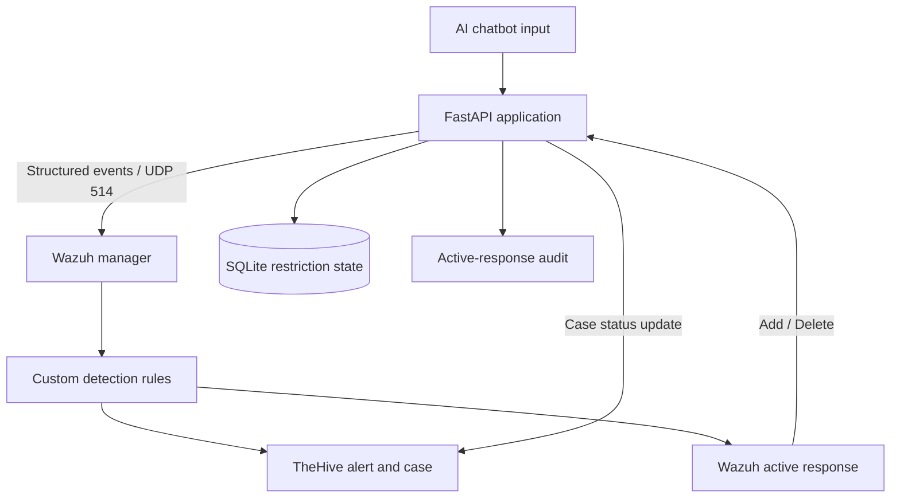

# Wazuh AI SOC Lab — AI Threat Detection and Automated Response

A defensive cybersecurity lab integrating a deliberately vulnerable AI chatbot, Wazuh SIEM, TheHive case management, and a custom active-response workflow.

**Status:** Working prototype. The single-alert detection-to-response lifecycle has been tested. Overlapping alerts for the same user are a known limitation.

## Objectives

- Send structured security events from an AI application to Wazuh.
- Detect selected AI-abuse patterns using custom Wazuh rules.
- Create and link TheHive alerts and cases.
- Apply temporary defensive restrictions through an authenticated FastAPI endpoint.
- Remove restrictions after Wazuh's active-response timeout.
- Record response actions for auditing.

## Architecture

## Technology stack

- Python and FastAPI
- Wazuh SIEM and custom rules
- TheHive alert and case management
- SQLite state and audit storage
- Docker Compose

## Custom detection rules

| Rule ID | Detection purpose | Level |
|---|---|---:|
| `100900` | Prompt-injection pattern | 10 |
| `100901` | Sensitive-information extraction pattern | 10 |
| `100902` | Safety-bypass pattern | 10 |
| `100903` | Active-response audit event | 3 |

These are lab-specific rules. They need further tuning and testing against benign and adversarial inputs.

## Response workflow

1. The AI application sends a structured event to Wazuh.
2. A custom rule generates an alert.
3. A custom integration creates a TheHive alert/case and links it to the affected user.
4. Wazuh executes a custom active-response script with an `add` action.
5. The application records a temporary restriction.
6. After the configured 300-second timeout, Wazuh sends a `delete` action.
7. The application removes the restriction and records the response.
8. The linked TheHive case is transitioned to `Indeterminate`, which appeared in the Closed stage during testing.

## Verification performed

The following single-alert lifecycle was verified:

- A synthetic prompt-injection event matched rule `100900`.
- TheHive case creation and linking succeeded.
- The active-response add request returned HTTP 200 and stored the restriction.
- The timeout delete request returned HTTP 200 and removed the restriction.
- The linked TheHive case transitioned to `Indeterminate` / Closed.
- Audit records existed for both add and delete actions.

These results demonstrate the tested workflow, not production readiness or complete detection coverage.

## Known limitation

The current `flagged_sessions` table stores one restriction row per user. If multiple alerts for the same user overlap, an earlier timeout can remove the restriction while a newer alert is still active.

**Planned improvement:** Track active response instances by `(user_id, alert_id)` and remove the restriction only when no active instances remain. Test duplicate events, missing alert IDs, overlapping timeouts, and TheHive API failures.

## Security

- Keep the intentionally vulnerable application isolated; do not expose it publicly.
- Never commit `.env`, real API keys, active-response tokens, certificates, private keys, raw logs, or runtime databases.
- Rotate credentials that may have been exposed.
- Restrict access to Wazuh and TheHive management interfaces.
- Publish only sanitized screenshots and synthetic test data.
- This project is a learning prototype, not a production-ready SOC platform.

## Future work

- Implement per-alert restriction tracking.
- Add automated concurrency and failure tests.
- Evaluate detection false positives and false negatives.
- Add health checks and structured, redacted logging.
- Document clean deployment and recovery procedures.
